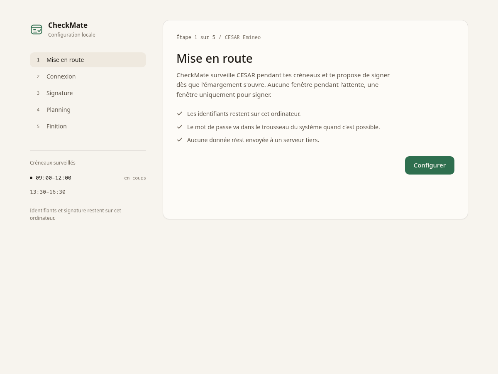
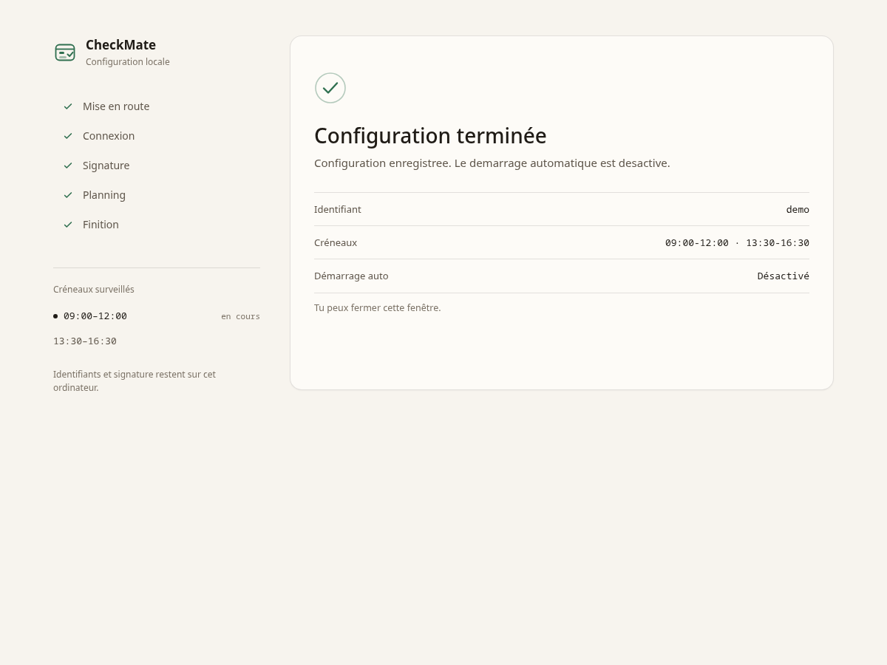

<div align="center">
  
  <h1>CheckMate</h1>
  <p><strong>Surveille CESAR et signe l'émargement sans y penser.</strong></p>

  
  
  
  
  
  

  [Télécharger](https://github.com/MattiaPARRINELLO/autologin/releases/latest) ·
  [Documentation](watcher/docs/README.md) ·
  [Présentation](watcher/presentation/index.html) ·
  [Vie privée](PRIVACY.md)
</div>

---

## En résumé

CheckMate est une petite application de bureau pour les étudiants qui utilisent
CESAR Emineo. Elle surveille tes créneaux de cours, repère le moment où le
formateur ouvre l'émargement, te prévient, puis signe à ta place avec la
signature que tu as dessinée.

Tu n'as pas besoin de garder un onglet CESAR ouvert, ni de cliquer sur un bouton
au bon moment. Pendant l'attente, aucun navigateur ne s'affiche. Une fenêtre
s'ouvre uniquement au moment de signer, puis se referme.



## Le problème que ça règle

Sur CESAR, le bouton d'émargement n'apparaît pas tout seul. Il faut rafraîchir
la page pour le voir. Et il reste ouvert peu de temps.

Dans une journée de cours, ça donne deux moments à ne pas rater :

| Créneau | Moment |
|---------|--------|
| Matin | 09:00 - 12:00 |
| Après-midi | 13:30 - 16:30 |

Si tu es en train de suivre le cours, de prendre des notes ou simplement loin
de ton écran, tu peux manquer la fenêtre. CheckMate s'en occupe à ta place.

## Ce que fait CheckMate, étape par étape

1. **Il attend le bon créneau.** En dehors des plages configurées, il ne fait
   rien. Aucun navigateur, aucune requête.
2. **Il vérifie CESAR toutes les 10 secondes.** Il recharge la page pour voir si
   le bouton d'émargement est apparu.
3. **Il te prévient.** Une notification s'affiche et une petite fenêtre te
   demande si tu es présent.
4. **Tu réponds.** Sur "Je suis présent", il ouvre un navigateur visible,
   reproduit ta signature, valide, puis referme la fenêtre.
5. **Il se met en pause.** Une fois le créneau signé, il ne vérifie plus rien
   jusqu'au créneau suivant.

Détection typique : 10 à 15 secondes après l'ouverture par le formateur.

## Ce qu'il ne fait pas

CheckMate ne prend pas de décision à ta place.

- il ne signe jamais sans que tu aies confirmé
- il ne connaît pas tes notes, tes absences ou tes justificatifs
- il ne contourne pas un captcha ou une double authentification
- il ne fonctionne pas si l'ordinateur est éteint
- il ne sert pas à falsifier une présence : tu dois être réellement présent au
  cours et signer uniquement pour toi
- il n'est pas affilié à CESAR, Emineo Education ou ton établissement

CESAR et Emineo sont des noms et des marques appartenant à Emineo Education et à
leurs titulaires respectifs, cités uniquement pour décrire l'interopérabilité du
logiciel. L'auteur n'est pas responsable de ce qui est fait avec CheckMate ni des
conséquences qui en découlent. Tu restes seul responsable de l'usage de ta
signature et du respect des règles de ton école. Voir les
[mentions légales](watcher/docs/mentions-legales.md).

## Installation sur Windows

### Ce qu'il te faut

- Windows 10 ou Windows 11
- Microsoft Edge ou Google Chrome
- l'ordinateur allumé et ta session ouverte au moment des cours

### Les étapes

1. Va sur la page de la dernière version stable :
   [CheckMate desktop](https://github.com/MattiaPARRINELLO/autologin/releases/latest).
2. Télécharge `CheckMate-Setup-<version>.exe`, en remplaçant `<version>` par le
   numéro affiché sur la page des releases.
3. Lance l'installeur. Il s'installe dans ton dossier utilisateur, sans demander
   les droits administrateur.
4. Windows peut afficher un avertissement SmartScreen. C'est normal tant que la
   signature de code n'est pas active : clique sur "Informations
   complémentaires", puis "Exécuter quand même".
5. À la fin de l'installation, l'assistant de configuration s'ouvre dans une
   fenêtre CheckMate native. Si WebView2 est absent, il s'ouvre dans ton
   navigateur.

L'installeur crée un raccourci dans le menu Démarrer. Le raccourci ouvre le
tableau de bord. Utilise "Reconfigurer" pour relancer l'assistant.

L'assistant propose d'installer le démarrage automatique à l'ouverture de
session ; la case est cochée par défaut.

### Mettre à jour

La mise à jour se fait depuis CheckMate, sans retélécharger à la main :

1. ouvre le tableau de bord
2. clique sur "Vérifier les mises à jour"
3. si une version est disponible, clique sur "Installer X.Y.Z"

CheckMate télécharge le paquet, vérifie sa somme SHA256, puis l'installe en
arrière-plan avant de redémarrer. La configuration et la signature sont
conservées. Sur Windows, l'installeur ferme l'application puis la relance. Sur
Linux, le service s'arrête, l'archive est déployée, puis le service redémarre.

En ligne de commande :

```bash
checkmate-watcher update --check
checkmate-watcher update --yes
```

### Canal stable ou beta

Par défaut, CheckMate suit le canal `stable` : les préversions ne sont jamais
proposées. Pour recevoir les betas, ajoute ceci dans `[updates]` du fichier de
configuration :

```toml
[updates]
channel = "beta"
```

Le canal est affiché dans le tableau de bord, à côté de la version. Le bouton
d'installation installe toujours la version proposée pour le canal courant,
sans réglage supplémentaire. Pour revenir au stable, remets `channel = "stable"`
ou supprime la clé (valeur par défaut).

L'ancienne clé `include_prerelease = true` reste acceptée comme alias de
`channel = "beta"` lorsqu'elle est présente sans `channel`.

Le format des tags et la procédure de stabilisation sont décrits dans
[CONTRIBUTING.md](CONTRIBUTING.md).

Si une mise à jour casse quelque chose, réinstalle la version précédente depuis
la page des releases.

L'installation automatique des mises à jour arrivera après la mise en place de
la signature de code, pour ne pas exécuter un binaire non signé.

## Installation sur Linux

### Ce qu'il te faut

- une distribution avec systemd
- [uv](https://docs.astral.sh/uv/getting-started/installation/) pour installer
  les dépendances
- Chromium, Google Chrome ou Microsoft Edge
- pour la fenêtre native : PyGObject, GTK 3 et WebKit2. Sur Arch et Garuda,
  `python-gobject` et `webkit2gtk-4.1` ; sur Debian et Ubuntu, `python3-gi` et
  `gir1.2-webkit2-4.1`. Sans eux, le tableau de bord s'ouvre dans le navigateur.

### Les étapes

```bash
# remplace <version> par le numero affiche sur la page des releases
tar -xzf CheckMate-linux-<version>.tar.gz
cd CheckMate-linux-<version>
./install.sh
```

L'installateur installe l'application dans ton dossier utilisateur, crée le
service qui démarre à la connexion, ajoute une entrée **CheckMate** dans le menu
des applications, puis lance l'assistant si aucune configuration n'existe.

L'entrée du menu ouvre le tableau de bord dans une fenêtre CheckMate native.

## L'assistant de configuration

L'assistant t'accompagne en cinq écrans.

### 1. Mise en route

Il explique ce que fait CheckMate et ce qui reste sur ton ordinateur. Rien
n'est envoyé à un serveur.

### 2. Connexion CESAR

Tu saisis l'adresse du site, ton identifiant et ton mot de passe. Un bouton
"Tester la connexion" ouvre un navigateur invisible et vérifie que CESAR
accepte la connexion avant d'enregistrer quoi que ce soit.

### 3. Signature

Tu dessines ta signature à la souris ou au doigt. Elle sera rejouée à
l'identique dans le canvas de CESAR.

Tu peux aussi importer une signature déjà existante au format JSON (liste de
points x/y) via le bouton "Importer le JSON".

### 4. Planning

Par défaut, CheckMate surveille du lundi au vendredi, de 09:00 à 12:00 et de
13:30 à 16:30. Tu peux changer les jours et les horaires.

### 5. Finition

Tu testes la notification, tu choisis si CheckMate doit démarrer
automatiquement, puis tu termines. Un récapitulatif affiche l'identifiant, les
créneaux et l'état du démarrage automatique.



## Pendant un cours

Voici ce qui se passe concrètement.

1. Le formateur ouvre l'émargement sur CESAR.
2. CheckMate le voit au cycle suivant, en 10 secondes environ.
3. Une notification apparaît sur ton ordinateur. Une fenêtre demande
   "Je suis présent" ou "Absent".
4. Si tu cliques sur "Je suis présent", un navigateur visible s'ouvre, signe,
   affiche la confirmation deux secondes, puis se referme.
5. Si tu ne réponds pas dans les trois minutes, rien n'est signé. La demande
   revient cinq minutes plus tard.
6. Si tu réponds "Absent", CheckMate ne signe pas et ne te relance pas pour ce
   même émargement.

Une fois le créneau signé, CheckMate ne vérifie plus rien jusqu'au créneau
suivant.

## Planning et reprise

Le planning par défaut est celui de deux journées de cours :

| Jour | Créneaux |
|------|----------|
| Lundi à vendredi | 09:00 - 12:00 et 13:30 - 16:30 |
| Samedi et dimanche | aucun |

Tu peux modifier ces plages dans l'assistant. Une fois un créneau signé,
CheckMate s'arrête jusqu'au créneau suivant, même si tu redémarres
l'application.

Si l'ordinateur se met en veille entre deux créneaux, CheckMate détecte la
reprise en quelques minutes et reprend la surveillance.

## Tableau de bord et icône

Le raccourci "CheckMate" du menu Démarrer ouvre le tableau de bord, pas
l'onboarding. Il s'affiche dans une fenêtre CheckMate native, sans onglet ni
barre d'adresse, via WebView2. Si WebView2 est absent, CheckMate retombe sur le
navigateur par défaut.

Le tableau de bord affiche l'état de la surveillance, le créneau en cours, la
prochaine ouverture, les compteurs, la dernière détection et la dernière
signature. Il permet aussi de reconfigurer, tester la notification, vérifier les
mises à jour, ouvrir les logs ou quitter.

Une icône CheckMate apparaît dans la zone de notification Windows : verte quand
la surveillance est active, ambre hors créneau, sombre quand le créneau est
signé, rouge après une erreur. Un clic droit ouvre le menu.

Si le service n'est pas lancé, le raccourci le démarre.

## Notifications et confirmation

Sur Windows, la notification est un toast système. Sur Linux, c'est une
notification du bureau, avec une fenêtre de confirmation.

**Important** : coupe le mode silencieux et le mode "Ne pas déranger" avant de
tester. Windows peut envoyer le toast sans l'afficher. L'assistant te demande de
confirmer que tu l'as bien vu avant de terminer la configuration.

Sur Windows, la notification s'affiche sous le nom "CheckMate" (pas "Windows
PowerShell"). Si tu ne la vois pas, vérifie deux réglages : le mode "Ne pas
déranger" et l'interrupteur "CheckMate" dans Paramètres > Système >
Notifications.

La confirmation est volontaire. CheckMate ne signe pas dans ton dos. Si tu
veux tester, l'assistant propose un bouton "Tester la notification".

Si tu ne vois aucune notification, vérifie le mode "Ne pas déranger" ou le mode
concentration de Windows, puis relance le test.

## Vie privée et sécurité

CheckMate fonctionne entièrement sur ton ordinateur.

- **Aucun serveur CheckMate.** Il n'y a pas de compte, pas de cloud, pas de
  télémétrie.
- **Le seul service contacté est CESAR**, avec l'adresse que tu as configurée.
- **Le mot de passe** va dans le trousseau du système quand c'est possible
  (Credential Manager sur Windows, fichier privé sur Linux).
- **La signature** est stockée localement sous forme de points, pas d'image.
- **Les logs** ne contiennent jamais le mot de passe.

La politique complète est dans [PRIVACY.md](PRIVACY.md) et
[vie-privee.md](watcher/docs/vie-privee.md).

## Modifier la configuration

- **Windows** : raccourci "CheckMate" du menu Démarrer.
- **Linux** : `checkmate-watcher setup`.

Tu peux ainsi changer le mot de passe, redessiner la signature, modifier le
planning ou retester la notification.

Pour changer uniquement le mot de passe, en terminal sur Linux :

```bash
checkmate-watcher set-password
```

Pour oublier les émargements déjà traités après un test, en terminal sur Linux :

```bash
checkmate-watcher reset-state
systemctl --user restart checkmate-watcher
```

## Vérifier que tout fonctionne

Sur Linux et en développement :

```bash
checkmate-watcher self-test --notify
```

Le diagnostic vérifie le mot de passe, la signature, le navigateur, le
trousseau, le démarrage automatique, le planning et le dossier de données.

Sur Windows, relance le raccourci "CheckMate" et utilise "Tester la
notification" dans l'assistant.

### Logs

- **Windows** : `%LOCALAPPDATA%\checkmate-watcher\Logs\checkmate-watcher.log`
- **Linux** : `journalctl --user -u checkmate-watcher -f`

### Paquet de support

```bash
checkmate-watcher support-bundle
```

L'archive contient un diagnostic, la configuration sans mot de passe et les
derniers logs. Elle ne contient ni mot de passe ni signature.

## Questions fréquentes

### Est-ce que ça signe tout seul ?

Non. Par défaut, CheckMate demande confirmation. Il existe un mode automatique,
mais il n'est pas activé dans l'installation standard.

### Est-ce que ça marche si je suis absent ?

Si tu réponds "Absent", rien n'est signé. CheckMate ne te relance pas pour cet
émargement.

### Est-ce que ça marche si l'ordinateur est en veille ?

Oui, à condition qu'il soit rallumé et que ta session soit ouverte au moment du
cours. La reprise est détectée en quelques minutes.

### Est-ce que ça marche si CESAR change ?

Les sélecteurs sont configurables, mais une grosse mise à jour de CESAR peut
nécessiter une mise à jour de CheckMate. Les logs indiquent alors qu'aucun
bouton n'a été trouvé.

### Pourquoi un autre navigateur s'ouvre-t-il au moment de signer ?

C'est normal. Pour signer, CheckMate a besoin de piloter lui-même un
navigateur : il remplit le formulaire CESAR, reproduit la signature puis ferme
la fenêtre. Cela passe par Chromium, le seul moteur que l'automatisation
utilise ici, avec un profil dédié à CheckMate. Ton navigateur par défaut et ton
profil personnel ne sont donc ni ouverts ni modifiés.

Si plusieurs Chromium sont installés, tu peux imposer celui qui s'ouvre :

```toml
[watcher]
executable_path = "/usr/bin/chromium"
```

Le tableau de bord et l'assistant ne sont pas concernés : ils s'affichent dans
une fenêtre CheckMate native. `CHECKMATE_BROWSER=1` force leur ouverture dans
le navigateur par défaut.

### Est-ce que je peux utiliser plusieurs comptes CESAR ?

Une installation correspond à un compte. Pour un autre compte, il faut une
autre configuration.

### Où sont mes données ?

Sur ton ordinateur uniquement. Les chemins exacts sont affichés par
`check-config`.

### Est-ce que l'installeur est signé ?

Pas encore. La signature Windows sera assurée par la
[SignPath Foundation](https://signpath.org/) après acceptation du projet. En
attendant, SmartScreen affiche un avertissement au premier lancement.

## Désinstallation

### Windows

Paramètres, Applications, CheckMate, Désinstaller. Le démarrage automatique
est supprimé.

La configuration et la signature restent dans `%LOCALAPPDATA%\checkmate-watcher`.
Supprime ce dossier si tu veux tout effacer.

### Linux

```bash
systemctl --user disable --now checkmate-watcher
rm ~/.config/systemd/user/checkmate-watcher.service
rm -rf ~/.local/share/checkmate-watcher
rm -rf ~/.config/checkmate-watcher
```

## État du projet

- Version stable actuelle : celle du badge **version stable** en haut de ce
  README et de la
  [page des releases](https://github.com/MattiaPARRINELLO/autologin/releases/latest).
  Les mises à jour suivent le canal `stable` par défaut ; le canal `beta` reçoit
  les préversions.
- macOS : **pas encore supporté**. Le code contient des chemins `darwin`, mais
  il n'existe ni release, ni démarrage automatique (`launchd` prévu), ni
  validation réelle. Ne l'installe pas en pensant que c'est pris en charge.
- Validation Windows effectuée sur un runner GitHub Actions : bundle,
  connexion, signature, toast, Credential Manager, tâche planifiée et
  installeur.
- Vérification visuelle du toast et de l'installeur sur un Windows réel :
  à faire.
- Signature de code Windows : dossier SignPath en cours. Tant qu'elle n'est pas
  active, l'installeur publié n'est pas signé.

## Documentation

- [Guide utilisateur](watcher/docs/guide-utilisateur.md)
- [Vie privée](watcher/docs/vie-privee.md)
- [Dépannage](watcher/docs/depannage.md)
- [Mentions légales](watcher/docs/mentions-legales.md)
- [Validation Windows](watcher/docs/windows-validation.md)
- [Signature Windows](watcher/docs/signature-windows.md)
- [Branchement SignPath](watcher/docs/signpath-setup.md)
- [Présentation HTML](watcher/presentation/index.html)

## Périmètre et statut des surfaces

Le dépôt contient plusieurs surfaces, avec des statuts différents :

| Surface | Contenu | Statut |
|---------|---------|--------|
| [`watcher/`](watcher/) | application Python, CLI et tableau de bord local | maintenue, produit publié |
| [`emulator/`](emulator/) | serveur CESAR de test | maintenue, outil de test |
| [`ui/`](ui/) | tableau de bord expérimental en Rust (egui) | expérimentale, hors release |

L'application de bureau (`watcher/`) est le seul produit publié. `ui/` explore
une interface native alternative ; elle n'est pas livrée avec les releases et
peut casser sans préavis.

## Architecture du watcher

Le code de l'application est dans [`watcher/`](watcher/). Son architecture est
décrite dans [watcher/docs/architecture.md](watcher/docs/architecture.md) : carte
des modules, déroulé d'un cycle de surveillance, état persistant, tableau de
bord, onboarding et mises à jour.

En résumé, `watcher.py` porte la boucle, `http_session.py` détecte les
émargements en HTTP léger, `cesar.py` pilote la signature dans Chrome,
`browser.py` choisit le navigateur, `schedule.py` décide des créneaux,
`status_server.py` et `setup_server.py` servent les interfaces locales, et
`self_update.py` installe les mises à jour vérifiées.

## Développement

```bash
cd watcher
uv sync
uv run pytest
```

L'émulateur permet de tester tout le parcours sans le vrai CESAR :

```bash
python3 emulator/server.py --port 8787
cd watcher
uv run checkmate-watcher --config ../emulator/watcher.toml run -v
```

Pour contribuer, lire [CONTRIBUTING.md](CONTRIBUTING.md) : environnement,
conventions de commit, checks obligatoires et cycle de release. Le projet suit
le [code de conduite](CODE_OF_CONDUCT.md). Pour une faille de sécurité, utiliser
la [politique de sécurité](SECURITY.md), sans issue publique.

## Licence

MIT. Voir [LICENSE](LICENSE).
