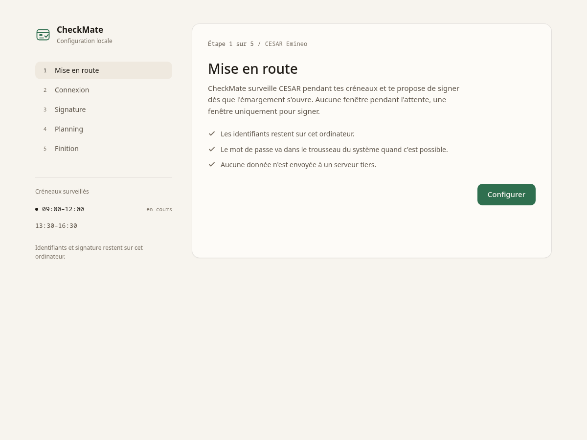
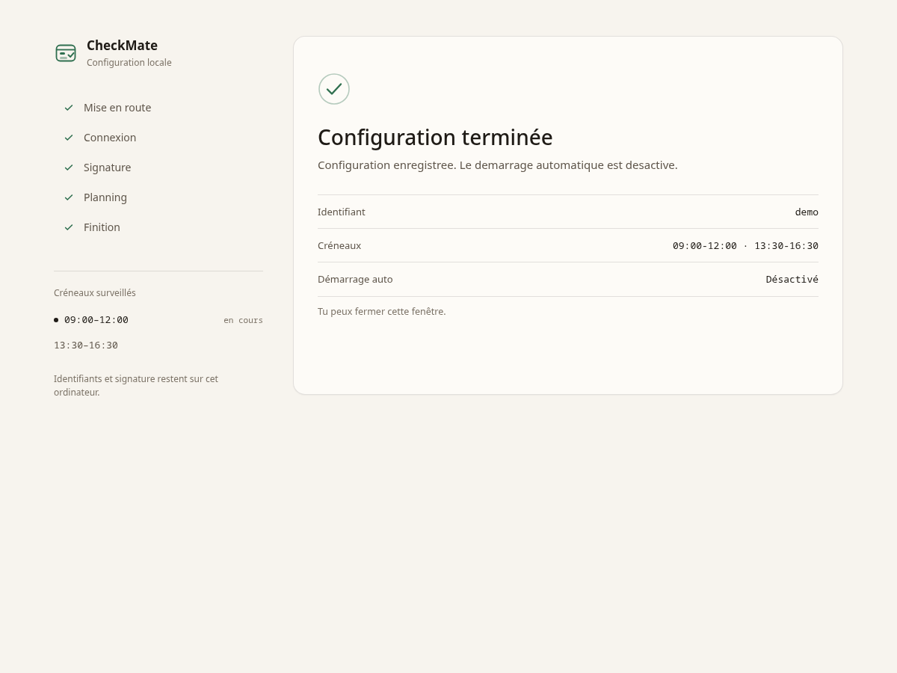

# Guide utilisateur

## Ce que fait CheckMate

CheckMate surveille CESAR Emineo pendant tes créneaux de cours. Dès qu'un
formateur ouvre l'émargement, tu reçois une notification, tu confirmes ta
présence, et la signature est rejouée automatiquement.

Pendant l'attente, aucun navigateur visible. Une fenêtre s'ouvre uniquement au
moment de signer, puis se referme.

## Prérequis

- Windows 10 ou 11, ou une distribution Linux avec systemd.
- Microsoft Edge, Google Chrome, Chromium, ou le Chromium de Playwright.
- L'ordinateur allumé et la session ouverte au moment du cours.

## Installation sur Windows

1. Télécharge `CheckMate-Setup-<version>.exe` depuis les releases GitHub.
2. Lance l'installeur. Il s'installe dans ton dossier utilisateur, sans droits
   administrateur.
3. Windows SmartScreen peut afficher un avertissement tant que l'exécutable
   n'est pas signé. Clique sur "Informations complémentaires" puis
   "Exécuter quand même".
4. À la fin, l'onboarding s'ouvre dans ton navigateur.

L'installeur crée un raccourci "CheckMate" dans le menu Démarrer et une tâche
planifiée qui démarre CheckMate à l'ouverture de session.

## Installation sur Linux

Télécharge l'archive `CheckMate-linux-<version>.tar.gz`, extrais-la, puis :

```bash
./install.sh
```

`uv` est requis : https://docs.astral.sh/uv/getting-started/installation/

L'installateur installe l'application dans `~/.local/share/checkmate-watcher`,
crée le service utilisateur systemd et lance l'onboarding si aucune
configuration n'existe.

## Onboarding

1. **Mise en route** : ce que fait CheckMate et ce qui reste sur l'ordinateur.
2. **Connexion CESAR** : identifiant et mot de passe, avec un test de connexion
   réel dans un navigateur invisible.
3. **Signature** : dessin à la souris ou au doigt.
4. **Planning** : jours et créneaux surveillés. Par défaut, du lundi au vendredi,
   09:00-12:00 et 13:30-16:30.
5. **Finition** : test de notification, démarrage automatique, récapitulatif.





## Pendant un cours

- CheckMate vérifie CESAR toutes les 10 secondes, uniquement dans les créneaux.
- Dès que le bouton d'émargement apparaît, une notification s'affiche.
- Une fenêtre demande "Je suis présent" ou "Absent".
- Sur "Je suis présent", un navigateur visible s'ouvre, signe, affiche la
  confirmation deux secondes, puis se referme.
- Une fois signé sur un créneau, CheckMate ne vérifie plus rien jusqu'au créneau
  suivant.

Si tu ne réponds pas dans les 3 minutes, rien n'est signé. La demande revient
5 minutes plus tard.

## Modifier la configuration

Relance l'assistant à tout moment :

```bash
checkmate-watcher setup
```

Pour changer le mot de passe seul :

```bash
checkmate-watcher set-password
```

Pour oublier les émargements déjà traités, par exemple après un test :

```bash
checkmate-watcher reset-state
```

Puis redémarre le service :

```bash
systemctl --user restart checkmate-watcher
```

## Vérifier l'installation

```bash
checkmate-watcher self-test --notify
```

Le diagnostic vérifie le mot de passe, la signature, le navigateur, le
trousseau, le démarrage automatique, le planning et le dossier de données.

Le chemin des logs s'affiche avec :

```bash
checkmate-watcher --config ~/.config/checkmate-watcher/config.toml check-config
```

Sur Linux : `journalctl --user -u checkmate-watcher -f`.
Sur Windows : le fichier `checkmate-watcher.log` dans le dossier de logs affiché
par `check-config`.

## Désinstallation

**Windows** : Paramètres, Applications, CheckMate, Désinstaller. La tâche
planifiée est supprimée. La configuration et la signature restent dans
`%APPDATA%\checkmate-watcher` si tu veux les supprimer à la main.

**Linux** :

```bash
systemctl --user disable --now checkmate-watcher
rm ~/.config/systemd/user/checkmate-watcher.service
rm -rf ~/.local/share/checkmate-watcher
rm -rf ~/.config/checkmate-watcher
```

## Limites

- La machine doit être allumée et la session ouverte. En veille, la reprise est
  détectée en quelques minutes.
- Si CESAR ajoute une validation supplémentaire (2FA, captcha), la connexion
  automatique échouera et le self-test le signalera.
- Une mise à jour de CESAR peut casser les sélecteurs. Les logs indiquent alors
  qu'aucun bouton n'est trouvé.
- CheckMate signe à ta place, avec ta signature. Tu restes responsable de son
  usage.
